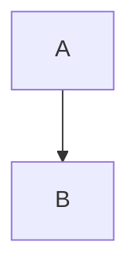

# Micro Shop Studio

Application Astro + Vue 3 permettant de générer une micro-boutique e-commerce à l'aide d'un endpoint OpenAI-compatible et du réseau multi-agents embarqué dans `src/ai-network/`.

## Fonctionnement

- Paramètres IA persistés dans `localStorage` : URL de base, clé API, modèle.
- Chargement automatique des modèles via le proxy Astro vers `GET <baseUrl>/models`.
- Appels IA via le proxy Astro vers `POST <baseUrl>/chat/completions` avec `stream: true`.
- Le proxy relaie le `ReadableStream` SSE de l'API distante sans le bufferiser ; le frontend reconstruit la réponse token/chunk par token/chunk.
- Pendant la génération, le panneau d'orchestration affiche l'étape courante, le nombre de caractères reçus et un aperçu live du flux IA.
- Le formulaire couvre `PROJECT_SPEC`, contraintes techniques, métier, sécurité, intégrations, visuels et dépôt existant.
- Le réseau n'est pas envoyé intégralement à chaque requête : chaque étape injecte uniquement le routeur, les agents et les skills utiles.
- Les captures visuelles sont envoyées à l'agent visuel via des contenus `image_url` OpenAI-compatibles.
- Le résultat est assemblé dans le navigateur puis téléchargeable en ZIP.
- Une fois la génération terminée, l'application affiche le projet sous forme d'arborescence dossiers/fichiers avec consultation du contenu de chaque fichier.
- La structure de données est produite dans `.ai/diagrams/data-model.md` sous forme de Markdown contenant un diagramme Mermaid `erDiagram` et bénéficie d'une preview dans l'application.
- Les autres diagrammes utiles sont générés dans `.ai/diagrams/*.md`, exclusivement en Markdown + Mermaid, puis affichés avec leur source et leur preview.
- Tous les agents/skills/contrats du réseau source sont copiés dans `.agents/` du projet généré.

## Diagrammes

La source canonique d'un diagramme est toujours un fichier Markdown contenant un bloc :

````markdown

````

Le générateur interdit les sources PlantUML, Graphviz/DOT, `.mmd`, `.puml`, `.plantuml`, `.dot` et `.gv`. Les SVG affichés dans l'interface sont uniquement le rendu temporaire de Mermaid et ne sont pas écrits dans le projet généré.

Le rendu des previews repose sur le package `mermaid` côté navigateur avec un niveau de sécurité strict.

## Limite importante

Après génération, l'application exécute les validations qu'elle peut réellement supporter dans le navigateur : Node.js via WebContainer, PHP via PHP.wasm et artefacts WASI/WASIX via Wasmer. Les erreurs exécutées sont transmises au fix-coordinator qui peut corriger les fichiers puis relancer jusqu'à 5 passes. Java, Go et Rust natifs ne sont jamais déclarés testés lorsque la compatibilité navigateur n'est pas démontrée.

## Développement

```bash
npm install
npm run dev
```

## Build

```bash
npm run build
npm start
```


## Génération fichier par fichier

Les lots du `BUILD_PLAN` restent des unités logiques d'orchestration, mais ils ne correspondent plus à une réponse IA unique. Pour chaque lot, le générateur parcourt la liste `files` dans l'ordre et effectue **un appel `/chat/completions` par fichier**. Le contenu est enregistré immédiatement dans l'état du projet avant de passer au fichier suivant.

Cette stratégie évite qu'une réponse contenant de nombreux fichiers atteigne la limite de sortie du modèle et se termine avec `finish_reason: "length"`, ce qui produisait auparavant des JSON tronqués (`Unterminated string in JSON`).

### Fichiers plus longs que la limite de sortie

Un fichier individuel peut lui-même être plus long que la fenêtre de rendu maximale du modèle. Dans ce cas, `finish_reason: "length"` n'est plus fatal : le générateur conserve le fragment reçu puis lance automatiquement une nouvelle completion pour demander uniquement la suite du même fichier.

Les continuations n'envoient pas tout le fichier déjà produit. Elles transmettent uniquement les **16 000 derniers caractères** comme point de raccord, puis concatènent le nouveau fragment. Si le modèle répète exactement une partie de la fin précédente, le chevauchement est détecté et supprimé. Le processus se répète jusqu'à une terminaison normale (`stop` ou équivalent), avec une garde de sécurité de **24 fragments maximum par fichier**. Le projet final contient toujours un seul fichier fusionné.

## Proxy OpenAI-compatible et CORS

Les appels IA ne sont pas effectués directement depuis le navigateur. Le frontend utilise deux routes serveur Astro :

- `POST /api/openai/models` → relaie vers `<baseUrl>/models` ;
- `POST /api/openai/chat/completions` → relaie vers `<baseUrl>/chat/completions`.

L'URL de base et la clé API restent persistées dans le `localStorage`, puis sont envoyées à la route Astro à chaque appel. Le serveur Astro ajoute l'en-tête `Authorization: Bearer ...` lorsqu'il contacte l'API distante. Le CORS de l'API OpenAI-compatible n'est donc plus exposé au navigateur.

Le projet utilise `@astrojs/node` en mode `standalone` et `output: 'server'`.

### Streaming

Les requêtes `/chat/completions` ajoutent systématiquement `stream: true`. Quand l'endpoint respecte le protocole OpenAI-compatible, il renvoie `text/event-stream` et Astro transmet directement `response.body` au navigateur. Aucun `response.text()`, `response.json()` ou `arrayBuffer()` n'est appelé dans le proxy sur ce chemin, ce qui évite d'attendre la génération complète avant d'envoyer le premier octet au frontend.

Le client parse les événements `data: {...}` et le marqueur `data: [DONE]`, concatène `choices[0].delta.content` et conserve également `finish_reason`. Les artefacts structurés restent parsés en JSON. En revanche, la phase d'implémentation ne demande plus un gros JSON contenant plusieurs fichiers : chaque fichier du `BUILD_PLAN` déclenche son propre appel streaming et le modèle retourne uniquement le contenu brut de ce fichier. Si un fichier se termine avec `finish_reason=length`, son contenu partiel est conservé et une ou plusieurs completions de continuation sont automatiquement lancées jusqu'à obtenir la fin du fichier. Si un endpoint ignore `stream: true` et renvoie malgré tout un JSON complet, un fallback de compatibilité reste actif.

Pour les reverse proxies nginx, la réponse SSE inclut également `X-Accel-Buffering: no` et `Cache-Control: no-cache, no-transform`.

L'application est conçue pour être utilisée comme outil local ou privé. Comme l'URL OpenAI-compatible est configurable, ne publiez pas le proxy sans contrôle d'accès sur un serveur accessible à des utilisateurs non fiables.

## Internationalisation

Quand l’option **Internationalisation** est activée, le formulaire propose les 184 langues ISO 639-1. Le français (`fr`) et l’anglais (`en`) sont sélectionnés par défaut.

La sélection est transmise explicitement au pipeline IA via `PROJECT_SPEC` et `I18N_SPEC`. Le plan de génération doit déclarer un catalogue de traduction pour chaque langue sélectionnée. Les builders reçoivent ensuite les règles applicatives imposant l’utilisation de clés i18n pour tous les wordings statiques visibles par l’utilisateur et la présence de chaque clé dans toutes les langues choisies.

Le fichier `.ai/i18n-spec.yaml` du projet généré conserve la sélection exacte et les contraintes i18n utilisées pendant la génération.


- I18n : la langue par défaut est choisie explicitement parmi les langues sélectionnées et propagée dans PROJECT_SPEC/I18N_SPEC.

## Dépôt existant

Lorsque **Dépôt existant = Oui — contraintes à préserver** est sélectionné, le générateur exige l'import d'un ZIP du projet. Le ZIP est analysé dans le navigateur : les dépendances/caches/builds usuels (`node_modules`, `.git`, `dist`, etc.) sont ignorés, un éventuel dossier racine unique est retiré, les fichiers texte servent de contexte ciblé à l'IA et les fichiers binaires sont conservés sans être envoyés au modèle. Les fichiers non modifiés restent présents dans le ZIP final ; les fichiers planifiés par l'IA sont générés à partir de leur contenu existant quand ils existent déjà.

### Retry automatique des réponses IA sans contenu final

Le client OpenAI-compatible détecte désormais les streams qui se terminent par `[DONE]` sans aucun `content` exploitable, y compris lorsque le modèle a uniquement émis des chunks `reasoning`. Dans ce cas, la requête complète est relancée automatiquement jusqu'à 3 tentatives. Les retries ajoutent une consigne explicite demandant au modèle de terminer son raisonnement par la réponse finale attendue. Si les 3 tentatives restent vides, une erreur détaillée indique le `finish_reason`, la présence du marqueur `[DONE]` et la quantité de reasoning reçue.


## Validation navigateur et preview

- **Node.js / Nuxt / Astro / Vue / React** : WebContainer monte le projet, installe les dépendances puis exécute les scripts `test`, `lint`, `typecheck/check` et `build` disponibles. Un script `dev`, `start` ou `preview` peut être exposé dans une iframe.
- **PHP** : PHP.wasm valide la syntaxe des fichiers PHP via `TOKEN_PARSE` et exécute `vendor/bin/phpunit` lorsqu'il est déjà présent dans le projet. Composer n'est pas prétendu exécuté automatiquement.
- **WASI/WASIX** : Wasmer exécute les artefacts `.wasm` compatibles.
- **Java / Go / Rust natifs** : garde de compatibilité ; aucun succès n'est inventé en l'absence d'un runtime navigateur démontré.

WebContainer et Wasmer ont besoin de `SharedArrayBuffer`. Le serveur Astro envoie donc `Cross-Origin-Opener-Policy: same-origin` et `Cross-Origin-Embedder-Policy: require-corp`. En production, servir l'application en HTTPS.

Les résultats de validation sont écrits dans `.ai/runtime-validation.json` et `.ai/testing/rapport-validation.md`.

### Persistance locale du formulaire

En développement local (`localhost`, `127.0.0.1`, `0.0.0.0` ou boucle locale IPv6), deux boutons flottants permettent de sauvegarder et de supprimer les données persistées du formulaire. Les sections sont stockées séparément dans `localStorage` sous le préfixe `micro-shop-generator:form:` et restaurées automatiquement au rechargement. La suppression des données enregistrées ne modifie jamais le formulaire actuellement affiché. Les uploads volumineux (ZIP de dépôt ou images) sont conservés uniquement s’ils tiennent dans le quota `localStorage`; sinon les autres champs restent sauvegardés et les fichiers devront être rechargés.

## Abstraction du contrôle du raisonnement

Le générateur n'est plus couplé à `chat_template_kwargs`. Les appels métier expriment uniquement une intention `thinking: true|false` :

- analyse, architecture, planification et artefacts structurés : reasoning activé ;
- génération/correction/continuation de fichiers : reasoning désactivé.

La couche `src/lib/reasoning.ts` traduit cette intention selon la stratégie configurée :

1. `reasoning_effort` (`medium` / `none`) ;
2. `chat_template_kwargs.enable_thinking` pour vLLM ;
3. fallback par prompt `/think` / `/no_think` accompagné d'une instruction générique ;
4. possibilité de ne faire aucun contrôle explicite.

En mode `auto`, les incompatibilités 400/422 liées aux paramètres de reasoning déclenchent le fallback suivant. La stratégie acceptée est mémorisée dans `localStorage` par URL d'API et modèle. Le cache peut être réinitialisé depuis la page Paramètres.

## Inspecteur des appels IA

L'interface principale expose un inspecteur permettant de consulter le prompt initial avant génération puis, pour chaque appel réellement exécuté, le prompt envoyé après adaptation du provider de reasoning, le reasoning reconstitué et la réponse finale reconstituée. Les étapes de la colonne d'orchestration sont cliquables et ouvrent l'inspecteur filtré sur l'étape correspondante. Le reasoning est affiché séparément et replié par défaut dans le détail d'un appel.

## Refonte UI / thèmes

L'interface utilise désormais un design system partagé entre le générateur et les paramètres : tokens CSS light/dark, shell latéral, topbar, cartes, formulaires, panneau d'orchestration et composants d'icônes réutilisables. Le thème suit le système par défaut et peut être forcé via le sélecteur à trois états **Clair / Système / Sombre** dans la page Paramètres IA. Le choix est conservé dans `localStorage` sous `micro-shop-generator:theme:v1`.

## Temperature IA

La page **Paramètres IA** permet de définir la valeur `temperature` utilisée par les appels `/chat/completions`. La valeur est persistée avec les autres paramètres dans `micro-shop-generator:ai-settings:v1` et réutilisée pour la génération, les continuations de fichiers, la validation/correction IA et l'inspecteur de prompts. La valeur par défaut reste `0.1` afin de préserver le comportement historique du projet.

## Validation non bloquante

La validation post-génération est désormais entièrement non bloquante : le projet généré et son arborescence restent consultables et téléchargeables pendant l'exécution des tests. Un échec de runtime ou l'absence de correction proposée par le fix-coordinator termine la validation avec un statut d'échec sans invalider la génération. L'étape `Tests / validation` de l'orchestration affiche `🚫` lorsque la validation n'a pas abouti. Les modales Résultat, Tests/Validation et Preview sont ouvertes explicitement et ne se superposent plus.

## Contrôle manuel de l’étape IA

Pendant une génération, l’étape IA active peut être contrôlée depuis le panneau d’orchestration :

- **Recommencer l’étape** annule uniquement la requête IA courante et la relance avec exactement le même contexte.
- **Abandonner l’étape** annule la requête courante, enregistre l’abandon dans `.ai/generation-state.json`, puis poursuit le pipeline. Cet état est injecté dans les prompts suivants afin que les agents sachent que l’étape n’a pas été accomplie.

Pour un fichier généré en plusieurs fragments, l’action de recommencement porte sur la requête/fragment courant ; l’abandon passe directement au fichier suivant.

## Gestion automatique des très grands contextes

Avant chaque appel IA, l'application estime puis tente de compter les tokens via l'endpoint OpenAI-compatible `/tokenize` (vLLM). Si le provider ne l'expose pas, un estimateur conservateur est utilisé. Avec une fenêtre de référence de 131072 tokens, 16384 tokens sont réservés à la sortie et 4096 tokens à la marge de sécurité.

Si le prompt dépasse le budget d'entrée, l'application ne supprime pas silencieusement des sections : elle découpe le contexte brut, construit un **Context Ledger** par passes successives, consolide les informations distinctes, puis exécute l'étape avec ce ledger. Les chunks bruts et les contextes consolidés sont ajoutés au projet généré sous `.ai/context/` (`ledger.json`, `chunks/`, `stage-contexts/`). Le contenu de `src/ai-network` n'est pas modifié par ce mécanisme.


## Vite 8 / PHP.wasm

Le build intercepte l’import binaire de `@php-wasm/web-8-4` via un plugin Vite local. Le module Emscripten attend une URL d’asset en export par défaut, alors que Vite 8/Rolldown interprète sinon le `.wasm` comme un module WebAssembly et échoue avec `MISSING_EXPORT`. Le plugin `micro-shop:php-wasm-asset-url` remplace uniquement cet import par un module virtuel qui émet le binaire comme asset et exporte son URL finale.

## Phase i18n finale déterministe et garde anti-boucle

Lorsque l’internationalisation est activée, les fichiers de catalogues déclarés dans `BUILD_PLAN.i18n.locales[].resourceFiles` ne sont plus générés pendant les lots d’implémentation. Les pages, composants, layouts, services et routes API sont d’abord produits avec des clés i18n stables. Une phase finale extrait ensuite de façon déterministe les clés réellement référencées par le code, conserve leur contexte d’usage dans `.ai/i18n/usages.json`, puis génère les traductions par lots bornés de clés.

Chaque lot de traduction doit retourner exactement l’ensemble de clés demandé. Les clés manquantes, supplémentaires, renommées ou les sorties présentant une dégénérescence sont rejetées puis retentées. Les catalogues finaux sont rendus par l’application elle-même (JSON/TS/JS/YAML/properties selon le chemin déclaré), ce qui évite les longues continuations IA pour les fichiers de traduction. Le registre canonique est écrit dans `.ai/i18n/keys.json` et la parité finale dans `.ai/i18n/report.json`.

La génération générale des fichiers utilise également des checkpoints : un fragment n’est ajouté au fichier courant qu’après passage du garde anti-dégénérescence. Les motifs de suffixes répétés/croissants de type `ValueValueValue` ou `...thianthianthian...` provoquent l’annulation du fragment, son rejet complet et une reprise depuis le dernier checkpoint sain. Après trois rechutes sur le même fragment, le fichier est arrêté au lieu de propager une boucle sur de nombreuses continuations. Le nombre maximal de fragments successifs est désormais borné à 12.
